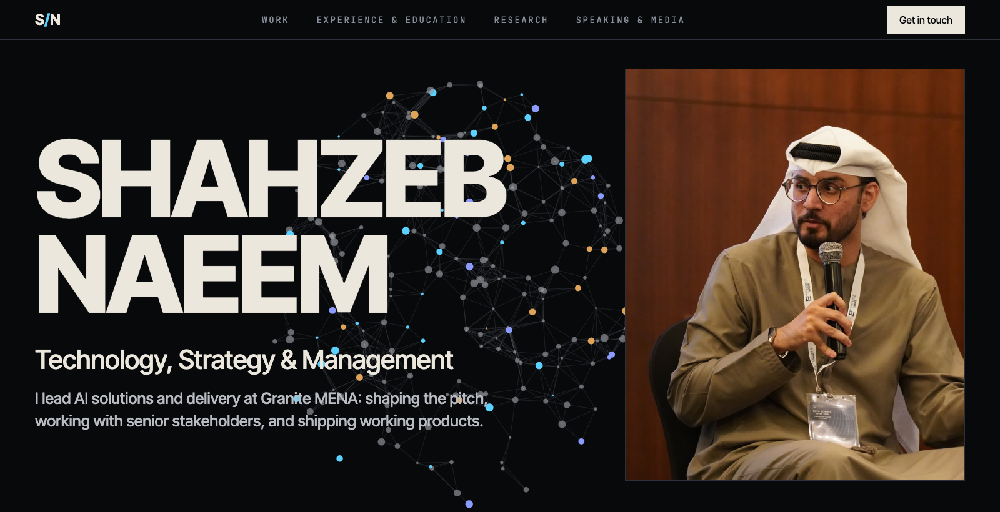
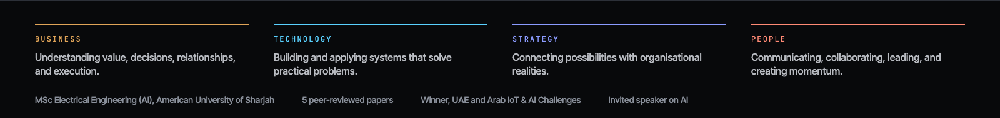
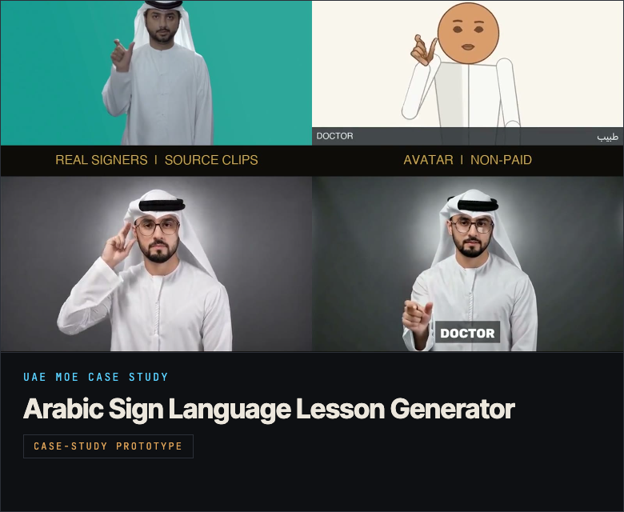
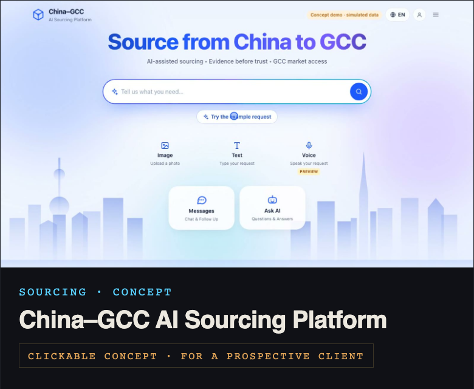
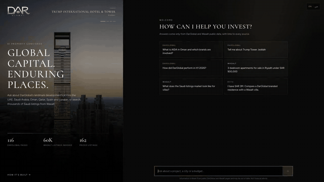
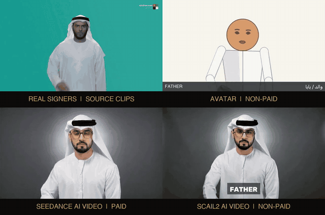
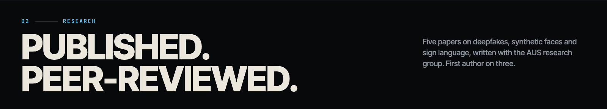
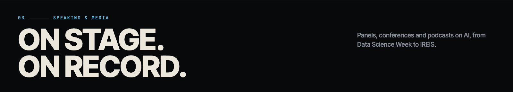
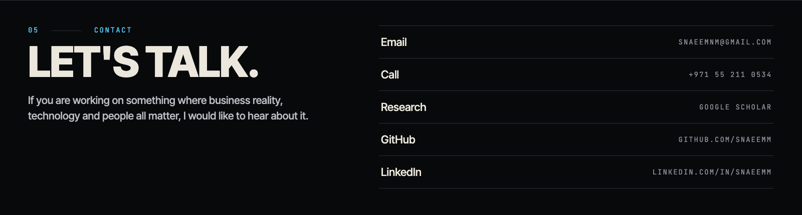

**[Portfolio](https://shahzeb-naeem.vercel.app)** &nbsp;·&nbsp; **[Résumé](Shahzeb_Naeem_Resume.pdf)** &nbsp;·&nbsp; **[LinkedIn](https://www.linkedin.com/in/snaeemm/)** &nbsp;·&nbsp; **[Google Scholar](https://scholar.google.com/citations?user=mcm907QAAAAJ&hl=en)** &nbsp;·&nbsp; **[Email](mailto:snaeemnm@gmail.com)**

<table>
<tr>
<td width="50%"></td>
<td width="50%"></td>
</tr>
<tr>
<td>Eight tools, one client team. An in-house agentic app that files email and meetings by client, builds quotes from the rate card, and turns "which clients need attention this week?" into a presentation. <i>Built at Granite MENA, so there is no public code.</i></td>
<td>Source-traceable sign-language lessons built from approved material, with a human review gate. 86.4% verified sign coverage on the demonstrated lesson. <a href="https://github.com/snaeemm/ESL"><b>Code →</b></a></td>
</tr>
<tr>
<td width="50%"></td>
<td width="50%"></td>
</tr>
<tr>
<td>A cited, honest property assistant over 60,000 Wasalt listings, built end to end in a day. <a href="https://darglobal-concierge.onrender.com"><b>Live demo →</b></a></td>
<td>A clickable concept for evidence-first supplier sourcing, from intake to RFQ draft. All data is fictional and labelled as such.</td>
</tr>
</table>

<b>Watch them move</b>

 

| Granite App | DarGlobal Concierge | Arabic Sign Language |
|---|---|---|
|  |  |  |

**Also built:** CivicFlow (policy-gated municipal workflows), Arabic Speech Intelligence and Football Analytics. [See them all →](https://shahzeb-naeem.vercel.app/en#work)

Five peer-reviewed papers on deepfakes, synthetic faces and adversarial attacks. [Full list on Google Scholar →](https://scholar.google.com/citations?user=mcm907QAAAAJ&hl=en)

<table>
<tr>
<td width="50%"> <b>Master AI, Master Your Career</b> Reach 4 Growth Podcast, Ep. 9</td>
<td width="50%"> <b>How AI is Transforming the Future</b> AI IXX</td>
</tr>
</table>

**[✉ snaeemnm@gmail.com](mailto:snaeemnm@gmail.com)** &nbsp;·&nbsp; **[📞 +971 55 211 0534](tel:+971552110534)** &nbsp;·&nbsp; **[LinkedIn](https://www.linkedin.com/in/snaeemm/)** &nbsp;·&nbsp; **[Résumé](Shahzeb_Naeem_Resume.pdf)** &nbsp;·&nbsp; **[Portfolio](https://shahzeb-naeem.vercel.app)**

