

**[Portfolio](https://shahzeb-naeem.vercel.app)** &nbsp;·&nbsp; **[Résumé](Shahzeb_Naeem_Resume.pdf)** &nbsp;·&nbsp; **[LinkedIn](https://www.linkedin.com/in/snaeemm/)** &nbsp;·&nbsp; **[Google Scholar](https://scholar.google.com/citations?user=mcm907QAAAAJ&hl=en)** &nbsp;·&nbsp; **[Email](mailto:snaeemnm@gmail.com)**

<a href="https://shahzeb-naeem.vercel.app/en#work">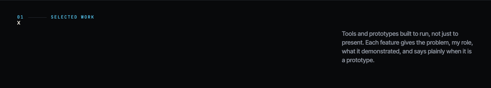</a>

<table>
<tr>
<td width="50%"><a href="https://shahzeb-naeem.vercel.app/en#work">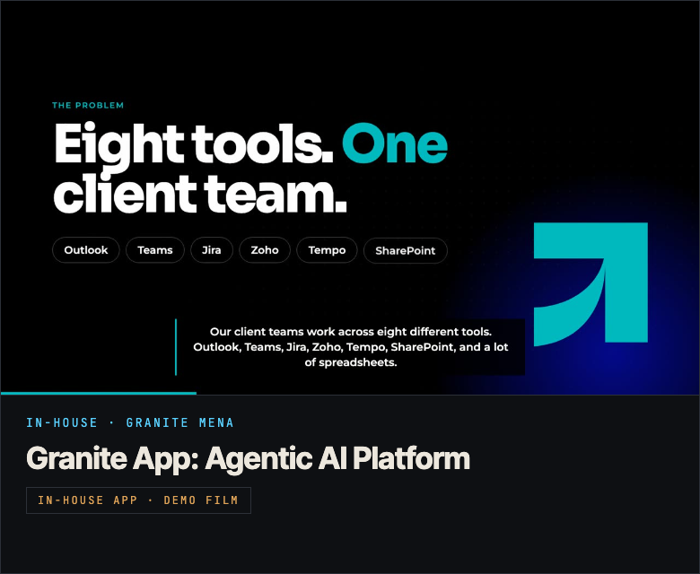</a></td>
<td width="50%"></td>
</tr>
<tr>
<td>Client teams work across eight tools. This in-house agentic app files email and meetings by client, builds quotes from the rate card, and turns "which clients need attention this week?" into a presentation. <i>Built at Granite MENA, so there is no public code.</i></td>
<td>Source-traceable sign-language lessons built from approved material, with a human review gate. 86.4% verified sign coverage on the demonstrated lesson. <a href="https://github.com/snaeemm/ESL"><b>Code →</b></a></td>
</tr>
<tr>
<td width="50%"><a href="https://shahzeb-naeem.vercel.app/en/work/darglobal-property-concierge">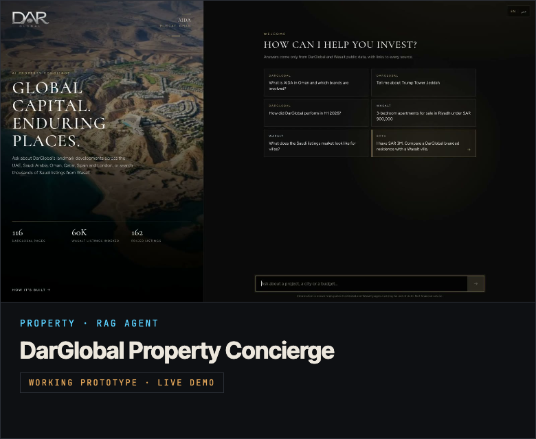</a></td>
<td width="50%"><a href="https://shahzeb-naeem.vercel.app/en/work/civicflow">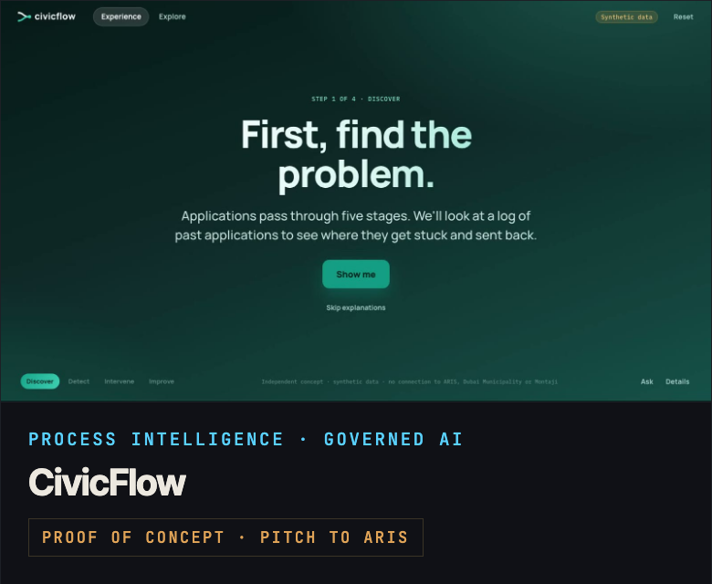</a></td>
</tr>
<tr>
<td>A cited, honest property assistant over 60,000 Wasalt listings, built end to end in a day. <a href="https://darglobal-concierge.onrender.com"><b>Live demo →</b></a> &nbsp; <a href="https://github.com/snaeemm/darglobal-property-concierge"><b>Code →</b></a></td>
<td>Catches document problems at intake instead of after a second review. 38.5% of synthetic cases loop back into document review. An independent proof of concept, not affiliated with Dubai Municipality or any vendor.</td>
</tr>
<tr>
<td width="50%"></td>
<td valign="top">
<b>Also built</b>  
Arabic Speech Intelligence · <i>built pipeline, no public demo</i>  
Football Analytics · <i>model work, no public demo</i>  
<a href="https://shahzeb-naeem.vercel.app/en#work"><b>All projects on the portfolio →</b></a>
</td>
</tr>
<tr>
<td>Evidence-first supplier sourcing for GCC buyers, from intake to RFQ draft. The closest match costs AED 1,800 more but keeps the required 8 mm. All data is fictional. <a href="https://github.com/snaeemm/china-gcc-ai-sourcing"><b>Code →</b></a></td>
<td></td>
</tr>
</table>

<b>Watch them move</b>

 

| Granite App | DarGlobal Concierge | Arabic Sign Language |
|---|---|---|
| 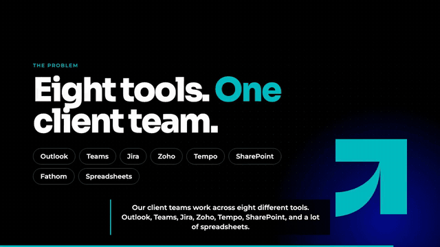 |  |  |

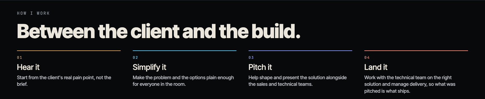

<a href="https://shahzeb-naeem.vercel.app/en#research">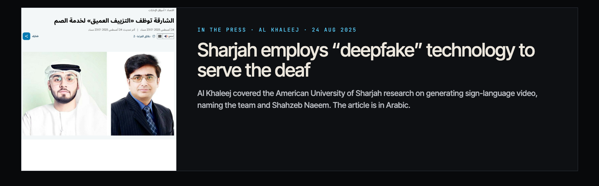</a>

<a href="https://ieeexplore.ieee.org/document/11105553">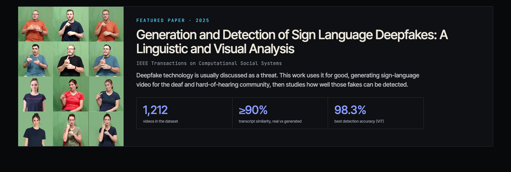</a>

| Year | Paper | Venue |
|---|---|---|
| 2025 | **[Generation and Detection of Sign Language Deepfakes: A Linguistic and Visual Analysis](https://ieeexplore.ieee.org/document/11105553)** | IEEE TCSS |
| 2025 | **Real, Fake, and Synthetic-Adversarial Attacks on Three Sides of the Coin** | IEEE ICIPW |
| 2024 | **Discrimination of Real and Deep Fake Videos using EEG Signals** | IEEE EMBC |
| 2024 | **[Real, Fake and Synthetic Faces: Does the Coin Have Three Sides?](https://ieeexplore.ieee.org/document/10581973)** | IEEE FG |
| 2023 | **Exploring Neurophysiological Responses to Cross-Cultural Deepfake Videos** | ACM ICMI (companion) |

32 citations, five papers, first author on three. [Full list on Google Scholar →](https://scholar.google.com/citations?user=mcm907QAAAAJ&hl=en)

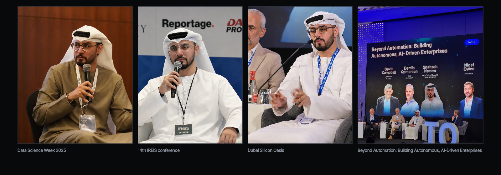
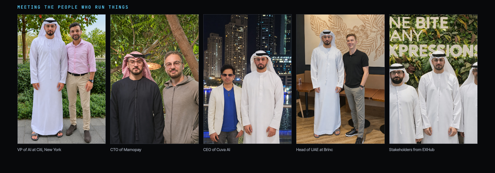
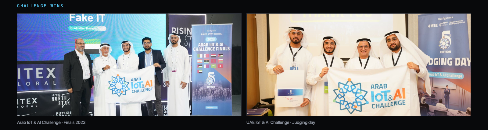

<table>
<tr>
<td width="50%"> <b>Master AI, Master Your Career</b> Reach 4 Growth Podcast, Ep. 9</td>
<td width="50%"> <b>How AI is Transforming the Future</b> AI IXX</td>
</tr>
</table>

<a href="https://shahzeb-naeem.vercel.app/en#experience">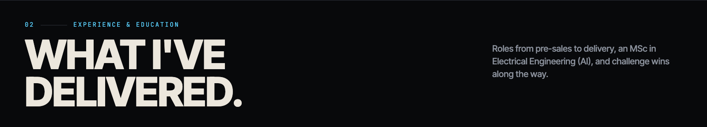</a>

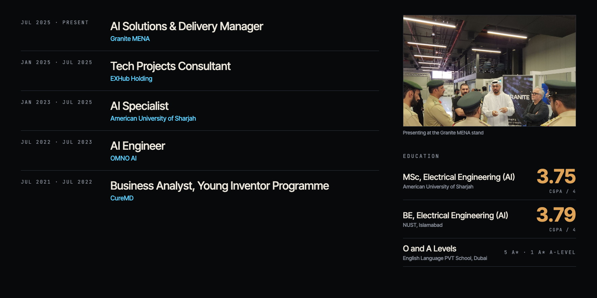

**[✉ snaeemnm@gmail.com](mailto:snaeemnm@gmail.com)** &nbsp;·&nbsp; **[📞 +971 55 211 0534](tel:+971552110534)** &nbsp;·&nbsp; **[LinkedIn](https://www.linkedin.com/in/snaeemm/)** &nbsp;·&nbsp; **[Résumé](Shahzeb_Naeem_Resume.pdf)** &nbsp;·&nbsp; **[Portfolio](https://shahzeb-naeem.vercel.app)**

